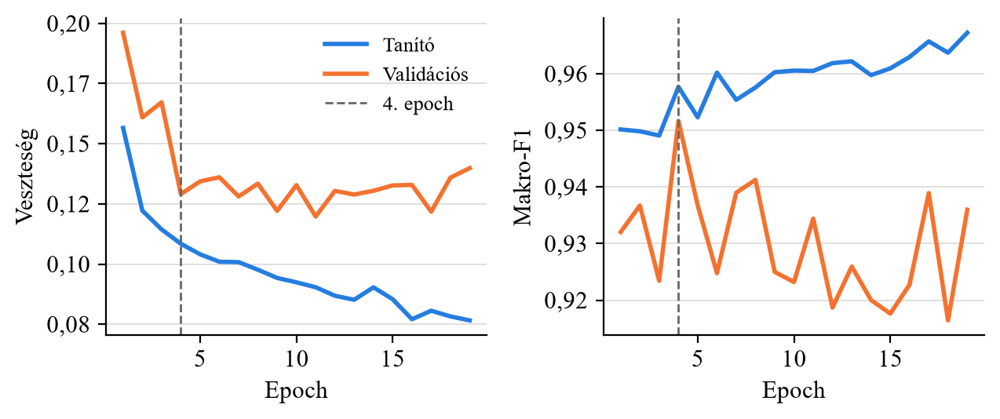
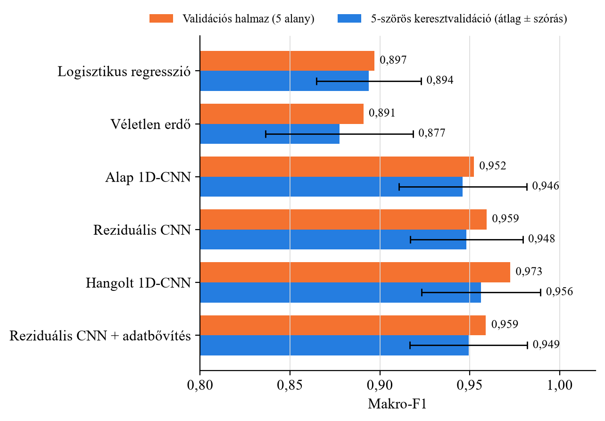
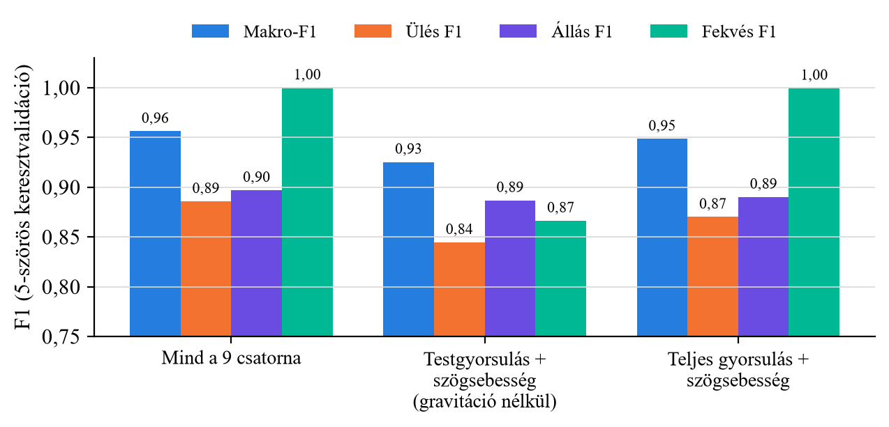
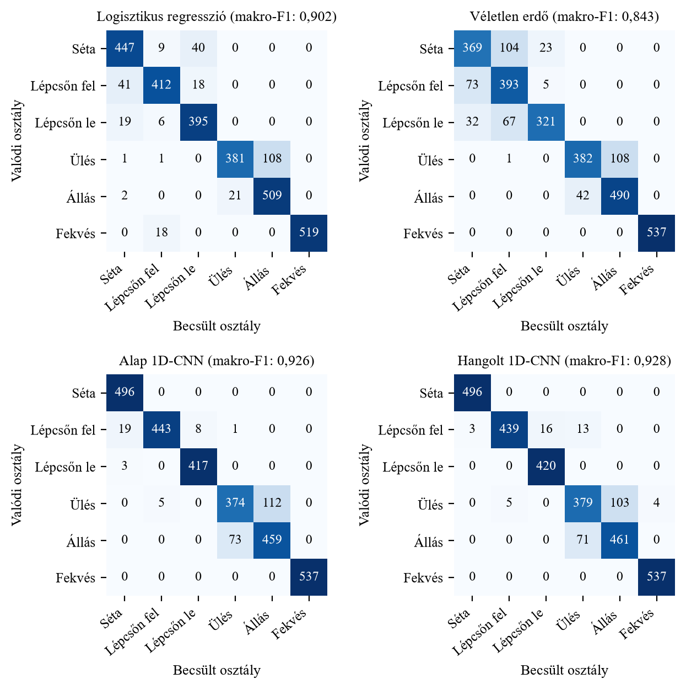
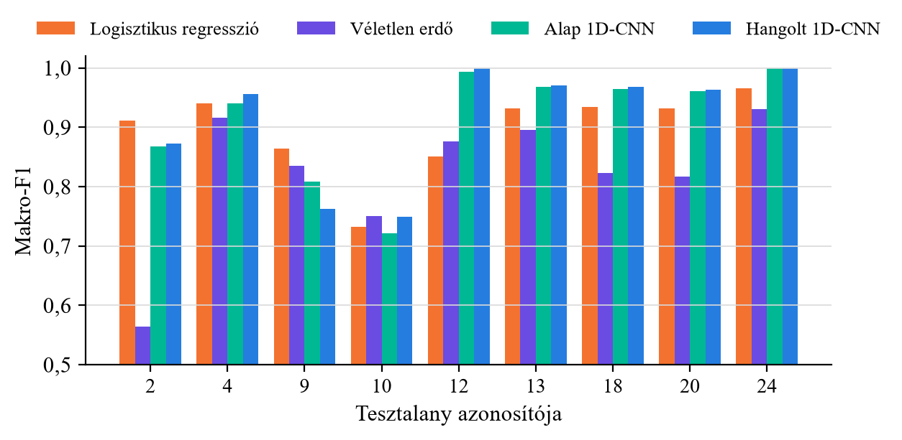

::: {custom-style="Author"}
Óbudai Egyetem Neumann János Informatika Kar
:::

::: {custom-style="Author"}
2026/27. tanév, 1. félév, Adattudomány MSc, levelező tagozat
:::

::: {custom-style="Author"}
2026\. december 5.
:::

```{=openxml}
<w:p><w:r><w:br w:type="page"/></w:r></w:p>
```

# Összefoglaló

A projekt azt vizsgálta, hogy egy kis méretű, nulláról tanított egydimenziós konvolúciós neurális háló (1D-CNN) jobban felismeri-e az emberi tevékenységeket okostelefon-szenzorjelekből, mint két klasszikus gépi tanulási modell. Az alapot az UCI HAR adatkészlet nyers gyorsulásmérő- és giroszkópjelei adták: 10 299 jelablak, 30 személy, 6 tevékenység. Az adatfelosztás személyek szerint történt, így a tesztszemélyek egyetlen ablaka sem szerepelt a tanításban. A tesztkiértékelés csak a legvégén, egyetlen alkalommal futott le.

A hangolt 1D-CNN a 9 tesztszemélyen 0,928 makro-F1 értéket ért el (pontosság: 92,7%). A logisztikus regresszió 0,902-t, a véletlen erdő 0,843-at ért el. A háló előnye mindkét klasszikus modellel szemben szignifikáns (McNemar-próba). Mozgással járó tevékenységeknél sokkal jobb, az ülés és az állás szétválasztásában viszont gyengébb a logisztikus regressziónál. Egy elhagyásos vizsgálat azt is megmutatta, hogy a gravitációt tartalmazó gyorsulásjel nélkül a fekvés felismerése jelentősen romlik.

# 1. Szakirodalmi áttekintés

Az emberi tevékenységek felismerése (Human Activity Recognition, HAR) azt jelenti, hogy egy rendszer szenzorjelekből automatikusan megállapítja, mit csinál éppen egy ember: sétál, ül, fekszik vagy lépcsőzik. Ilyen rendszerek segítik például az egészségügyi megfigyelést és a mozgáskövető alkalmazásokat. Az okostelefonok erre kényelmes eszközök, mert gyorsulásmérőt és giroszkópot is tartalmaznak.

A korai okostelefonos megoldások két lépésben dolgoztak. Először a jeleket rövid ablakokra vágták, és minden ablakból sok, kézzel kitalált jellemzőt számoltak (például átlagot, szórást, energiát, frekvenciasávokat). Ezután ezekre a jellemzőkre klasszikus osztályozót tanítottak. Anguita és munkatársai [1] például egy telefonra tervezett, kis számításigényű, többosztályos tartóvektor-gépet (SVM) mutattak be. A projekt adatkészletét is ők tették közzé [2], 561 előre kiszámolt jellemzővel együtt. Ezek a módszerek gyorsak és jól értelmezhetők, de az eredményük azon múlik, mennyire jók a kiválasztott jellemzők. Az ablakszintű statisztikák ráadásul elveszítik a jel időbeli alakját, például a lépések ritmusát.

A konvolúciós neurális hálók [3], [4] mindkét problémán segítenek. Egy konvolúciós szűrő egy rövid mintát keres, és ugyanaz a szűrő végigcsúszik a jel teljes hosszán. A háló így maga tanulja meg, milyen rövid időbeli minták fontosak. Ronao és Cho [5] okostelefonos adatokon megmutatta, hogy a nyers jelekre tanított 1D-CNN jobb eredményt ad, mint a kézzel tervezett jellemzőkre épülő modellek. Ignatov [6] egy sekély, valós idejű futtatásra szánt 1D-CNN-t mutatott be, amelyet egyszerű statisztikai jellemzőkkel is kiegészített.

Két buktató befolyásolta a tervezést. Az első az értékelés módja. Az ablakok 50%-ban átfedik egymást, ezért véletlenszerű ablakfelosztásnál ugyanannak a személynek szinte azonos ablakai kerülnek a tanító- és a teszthalmazba. Ez túl jó, félrevezető eredményt ad. Ezért az adatfelosztás személyek szerint történt. A második a gravitáció szerepe. A gyorsulásjel lassú, gravitációs része mutatja meg, hogyan dől a telefon. Ha ez a rész kimarad, a mozgások jobban látszanak, de a nyugalmi testhelyzetek (ülés, állás, fekvés) nehezebben különíthetők el. Ezt a hatást egy külön kísérlet mérte meg.

# 2. Problémafelvetés

## 2.1. A feladat

A bemenet egy 2,56 másodperces jelablak, amelyet egy derékra erősített okostelefon mért 50 Hz-es mintavétellel. Az ablak 9 csatornát és csatornánként 128 mintát tartalmaz, vagyis egy 9 × 128-as mátrix. A kimenet a hat tevékenység egyike: séta, lépcsőn fel, lépcsőn le, ülés, állás, fekvés. A modellnek olyan személyeken is jól kell működnie, akiktől a tanítás és a modellválasztás során egyetlen ablakot sem látott. Gyakorlati cél volt, hogy a háló kicsi maradjon (100 000 paraméter alatt), ne használjon előtanított modellt, és pontosan összevethető legyen a klasszikus modellekkel.

## 2.2. Kutatási kérdés és hipotézisek

Kutatási kérdés: személyek szerinti felosztás mellett jobb makro-F1 értéket ér-e el egy nulláról tanított, kis 1D-CNN a nyers jeleken, mint az ugyanabból a 9 csatornából számolt ablakstatisztikákra tanított klasszikus modellek? Melyik tevékenységeknél és melyik személyeknél maradnak hibák?

- H1: A konvolúció a jel időbeli alakját is látja (lépésritmus, a csatornák egymáshoz képesti időzítése), az ablakstatisztikák viszont nem. Ezért az 1D-CNN új személyeken jobb makro-F1 értéket ér el, főleg a mozgással járó tevékenységeknél. A nullhipotézis szerint nincs érdemi különbség.
- H2: Ha a bemenetből kimarad a teljes gyorsulásjel (amely a gravitációt is tartalmazza), és csak a gravitáció nélküli gyorsulás és a szögsebesség marad, romlik a nyugalmi testhelyzetek felismerése.

## 2.3. Mérőszámok

A fő mérőszám a makro-F1. Ez az osztályonként számolt F1-értékek egyszerű átlaga, így minden tevékenység ugyanannyit számít, akármennyi ablaka van. Az F1 a precizitás és a felidézés harmonikus közepe. A választás oka, hogy az osztályok mérete kissé eltér: a legkisebb és a legnagyobb osztály aránya a tanítóadatban 986 / 1407 = 0,70. A dokumentáció emellett közli a pontosságot (a helyesen besorolt ablakok arányát), az osztályonkénti F1-et, a tévesztési mátrixot (melyik valódi osztályt melyik osztálynak jósolta a modell) és a személyenkénti makro-F1-et.

# 3. Az adatkészlet

## 3.1. Forrás és előfeldolgozás

Az UCI HAR adatkészletben [2] 30 önkéntes (19–48 év) szerepel, akik derékra rögzített Samsung Galaxy S II telefonnal végezték el a hat tevékenységet. A telefon gyorsulásmérője és giroszkópja 50 Hz-en mért. Az adatkészlet szerzői a jeleket zajszűrték (mediánszűrő és 20 Hz-es aluláteresztő Butterworth-szűrő), majd egy 0,3 Hz-es aluláteresztő szűrővel kettébontották a gyorsulást gravitációs és testmozgásból származó részre. Végül a jeleket 2,56 s hosszú, 50%-ban átfedő ablakokra vágták. Az adatkészlet 561 előre kiszámolt jellemzőt is tartalmaz, ezek nem szerepelnek a projektben. A modellek bemenete az `Inertial Signals` mappa 9 nyers jele (1. táblázat).

Table: 1. táblázat. A 9 bemeneti csatorna.

| Csatorna neve a fájlokban | Magyar elnevezés | Tartalom | Mértékegység |
|----------------------------|--------------------|------------------------------------|----------------|
| total_acc_x/y/z | teljes gyorsulás | gyorsulás a gravitációval együtt | g |
| body_acc_x/y/z | testgyorsulás | gyorsulás a gravitáció nélkül | g |
| body_gyro_x/y/z | szögsebesség | a giroszkóp jele | rad/s |

## 3.2. Az adatok ellenőrzése

A `src/phases/inspect_data.py` szkript minden fájlt beolvasott és ellenőrzött. Nincs hiányzó vagy végtelen érték, és nincs két teljesen azonos ablak. A hivatalos tanítórészben 7 352 ablak van 21 személytől, a tesztrészben 2 947 ablak 9 személytől, és egyetlen személy sem szerepel mindkettőben. Egy személyre 281–409 ablak jut. A 2. táblázat az osztályok eloszlását mutatja.

Table: 2. táblázat. Az ablakok száma tevékenységenként.

| Tevékenység (eredeti címke) | Tanítórész | Tesztrész |
|--------------------------------------------------|------------------------:|------------------------:|
| Séta (WALKING) | 1 226 (16,7%) | 496 (16,8%) |
| Lépcsőn fel (WALKING_UPSTAIRS) | 1 073 (14,6%) | 471 (16,0%) |
| Lépcsőn le (WALKING_DOWNSTAIRS) | 986 (13,4%) | 420 (14,3%) |
| Ülés (SITTING) | 1 286 (17,5%) | 491 (16,7%) |
| Állás (STANDING) | 1 374 (18,7%) | 532 (18,1%) |
| Fekvés (LAYING) | 1 407 (19,1%) | 537 (18,2%) |
| Összesen | 7 352 | 2 947 |

A csatornák nagyon különböző tartományban mozognak. A testgyorsulás szórása 0,11–0,19 g, a szögsebesség −5,97 és +5,75 rad/s között változik, a teljes gyorsulás x tengelyének átlaga pedig a gravitáció miatt 0,80 g. Ezért a háló bemenete csatornánként standardizálva van, és a standardizálás csak a tanítóadat átlagát és szórását használja.

# 4. Módszer

## 4.1. Adatfelosztás

A felosztásnál az volt a szabály, hogy egy személy minden ablaka ugyanabba a halmazba kerül. Ezt a kód minden felosztás után ellenőrzi. A hivatalos 21 tanítószemély a `StratifiedGroupKFold` eljárással (4 részre bontva, 42-es véletlenmaggal) két csoportra oszlott:

- tanítóhalmaz: 16 személy, 5 563 ablak;
- validációs halmaz: 5 személy (6., 11., 17., 21., 23.), 1 789 ablak.

A hiperparaméterek kiválasztását ezen felül 5-szörös keresztvalidáció is segítette mind a 21 tanítószemélyen. Ilyenkor az adat öt részre oszlik, a modell mindig négy részen tanul, a mérés a kimaradt ötödiken történik, végül az öt eredmény átlaga számít. A részek itt is személyek szerint készültek. A teszthalmaz a hivatalos 9 tesztszemély (2., 4., 9., 10., 12., 13., 18., 20., 24.) 2 947 ablaka.

A teljes folyamat öt lépésből (fázisból) áll, mindegyikhez egy szkript tartozik (3. táblázat). Minden szkript egy YAML konfigurációs fájlt olvas, és az eredményét JSON fájlba menti. A tesztadatot az 1. fázis csak ellenőrzésre olvasta be, a 2–4. fázis pedig csak a tesztszemélyek azonosítóit, hogy az átfedést ellenőrizze.

Table: 3. táblázat. A kód lépései.

| Fázis | Szkript | Feladat | Eredményfájl |
|--------|----------------------------------|------------------------|----------------------------------|
| 1. | `src/phases/inspect_data.py` | adatok ellenőrzése | `dataset_summary.json` |
| 2. | `src/phases/train_baselines.py` | klasszikus modellek | `baselines_results.json` |
| 3. | `src/phases/train_cnn.py` | alap 1D-CNN | `cnn_baseline_results.json` |
| 4. | `src/phases/tune_cnn.py` | hangolás, elhagyásos vizsgálat | `tuning_results.json` |
| 5. | `src/phases/eval_test.py` | egyszeri tesztkiértékelés | `final_test_results.json` |

## 4.2. Klasszikus modellek

A klasszikus modellek minden ablakból, csatornánként 8 egyszerű statisztikát kaptak: átlag, szórás, minimum, maximum, medián, interkvartilis terjedelem, négyzetes középérték, valamint a szomszédos minták különbségének átlagos abszolút értéke. Ez utóbbi azt méri, mennyire gyorsan változik a jel. Ez 9 × 8 = 72 jellemző ablakonként. Minden jellemző csak a saját ablakából készül, így itt nem tud információ átszivárogni a halmazok között.

- Logisztikus regresszió: a jellemzőket a tanítóadaton illesztett standardizálás után kapta meg. A regularizáció erőssége (C) a {0,05; 0,1; 1; 10} értékek közül az lett, amelyik a legjobb validációs makro-F1-et adta (legfeljebb 2000 iterációval).
- Véletlen erdő: 300 fa. A fák mélysége (korlát nélkül, 16, 12) és a levelek minimális mérete (1 vagy 2) ugyanígy, a validációs makro-F1 alapján dőlt el.

## 4.3. Az 1D-CNN

A háló három konvolúciós blokkból áll. Minden blokkban egy konvolúciós réteg, egy batch-normalizálás (a réteg kimenetét kötegenként standardizálja) és egy ReLU aktiváció van. Az első két blokk után egy max-pooling réteg felezi az ablak hosszát. A harmadik blokk után egy átlagolás következik az időtengely mentén, így minden szűrőből egyetlen szám marad. Ez az átlag a gravitáció irányát is megőrzi, ami a nyugalmi testhelyzetekhez kell. Végül egy dropout réteg (tanítás közben véletlenszerűen kinulláz néhány értéket) és egy lineáris réteg adja a hat osztály pontszámát. A 4. táblázat a hangolt háló felépítését mutatja.

Table: 4. táblázat. A hangolt 1D-CNN rétegei (az alakok egy ablakra vonatkoznak).

| Réteg | Kimenet alakja | Paraméterek |
|--------------------------------------------------------------|--------------------|-----------------:|
| Bemenet | 9 × 128 | 0 |
| Konvolúció (48 szűrő, 9 hosszú), batch-normalizálás, ReLU, max-pooling | 48 × 64 | 3 984 |
| Konvolúció (96 szűrő, 5 hosszú), batch-normalizálás, ReLU, max-pooling | 96 × 32 | 23 232 |
| Konvolúció (160 szűrő, 3 hosszú), batch-normalizálás, ReLU | 160 × 32 | 46 400 |
| Átlagolás az idő mentén, dropout (0,35) | 160 | 0 |
| Lineáris kimeneti réteg | 6 | 966 |
| Összesen | | 74 582 |

Az alap 1D-CNN ugyanígy épül fel, de 32, 64 és 128 szűrővel és 7, 5, 3 hosszú szűrőkkel, összesen 38 054 paraméterrel. A 9 minta hosszú első szűrő 0,18 másodpercet lát egyszerre. A kísérletekben egy reziduális változat is szerepelt: ebben minden blokk két konvolúciós rétegből áll, és a blokk bemenete hozzáadódik a kimenetéhez. Ez 126 278 paramétert jelent.

## 4.4. Tanítás

A hálók tanítása AdamW optimalizálóval és keresztentrópia-veszteséggel, 64 ablakos kötegekben (batch) zajlott. A tanulási ráta egy koszinuszgörbe szerint csökkent 10^−5^-ig. Egy epoch a tanítóhalmaz egyszeri teljes bejárása. Minden epoch után a kód kiszámolta a validációs makro-F1-et, és a legjobb epoch súlyait tartotta meg. Ha 15 epochon át nem javult az eredmény, a tanítás leállt (korai leállítás). Az alap hálónál a tanulási ráta 10^−3^, a súlycsökkentés (weight decay) 10^−4^, a dropout 0,3 volt, legfeljebb 60 epochig. A hangolt hálónál a tanulási ráta 8 · 10^−4^, a súlycsökkentés 5 · 10^−4^, a dropout 0,35 volt, legfeljebb 50 epochig, 0,05-ös címkesimítással. Címkesimításnál a helyes osztály célértéke 1 helyett 0,958, a többi öt osztály pedig egyenként 0,008-at kap, ami csökkenti a túlzott magabiztosságot.

A véletlenmagok rögzítettek voltak, a cuDNN determinisztikus módban futott, de GPU-n ez sem garantál bitre azonos eredményt. A futtatások Windows 11 alatt, Intel Core Ultra 9 285K processzoron és NVIDIA GeForce RTX 5090 videokártyán készültek, Python 3.11.9, PyTorch 2.11.0 (CUDA 12.8), scikit-learn 1.9.1 és NumPy 2.4.6 mellett.

# 5. Kísérletek és hangolás

## 5.1. Klasszikus modellek

Az 5. táblázat a klasszikus modellek eredményét mutatja a validációs halmazon és az 5-szörös keresztvalidációban.

Table: 5. táblázat. A klasszikus modellek eredményei (72 jellemző).

| Modell | Választott beállítás | Tanító makro-F1 | Validációs makro-F1 | Validációs pontosság | Keresztvalidáció makro-F1 |
|---------------------|-------------------|-----------:|------------:|-------------:|--------------------:|
| Logisztikus regresszió | C = 10 | 0,972 | 0,897 | 0,899 | 0,894 ± 0,029 |
| Véletlen erdő | korlát nélküli mélység | 1,000 | 0,891 | 0,898 | 0,877 ± 0,041 |

A logisztikus regresszió a mozgásokat jól felismerte (séta F1: 0,94), de a 325 ülő ablakból 104-et állásnak jósolt. Ezért az ülés F1 értéke csak 0,80, a 6. személynél pedig a makro-F1 0,78. A véletlen erdő a tanítóadatot hibátlanul megtanulta (1,000), az ülést és az állást jobban szétválasztotta (0,92 és 0,93), de a lépcsőn felfelé menést gyengén ismerte fel (0,78), és a 21. személyen csak 0,60 makro-F1-et ért el. A véletlen erdő számára a legfontosabb jellemzők a teljes gyorsulás x tengelyének mediánja, négyzetes középértéke és maximuma voltak, vagyis a telefon dőlése.

## 5.2. Az alap 1D-CNN

Az alap háló tanítása 27,8 másodpercig tartott. A legjobb validációs eredményt a 4. epochban érte el, a korai leállítás a 19. epoch után állította meg. A validációs makro-F1 0,952 (pontosság: 0,947), ami 0,055-tel jobb a logisztikus regressziónál és 0,061-gyel jobb a véletlen erdőnél. A háló mind az öt validációs személyen jobb volt mindkét klasszikus modellnél. A 94 validációs hibából 89 az ülés és az állás felcserélése volt. Az 1. ábrán látszik, hogy a 4. epoch után a tanító értékek tovább javulnak, a validációs értékek viszont ingadoznak. A háló tehát korán elkezd a tanítószemélyek sajátosságaihoz igazodni.

{width=100%}

## 5.3. Hiperparaméter-hangolás

Hiperparaméternek a tanítás előtt rögzített beállítások számítanak, például a tanulási ráta vagy a szűrők száma. Nyolc beállítás futott a validációs halmazon (6. táblázat). A legjobbak és a reziduális háló ezután 5-szörös keresztvalidációban is szerepeltek. A végső modell kiválasztása a keresztvalidációs átlag alapján történt, nem az egyetlen validációs halmaz alapján, mert az csak 5 személyt tartalmaz.

Table: 6. táblázat. A kipróbált beállítások. Az alap háló kivételével mindegyik 0,05-ös címkesimítást és nagyobb súlycsökkentést (5 · 10^−4^ vagy 10^−3^) használt, a pontos értékek a `configs/cnn_tuning.yaml` fájlban vannak. A keresztvalidáció csak a kiválasztott négy beállításra futott.

| Beállítás | Változtatás az alap hálóhoz képest | Paraméter | Legjobb epoch | Validációs makro-F1 | Keresztvalidáció makro-F1 |
|------------------|--------------------------|------------:|----------:|------------:|------------------:|
| Alap 1D-CNN | nincs | 38 054 | 4 | 0,952 | 0,946 ± 0,036 |
| Erősebb regularizáció | dropout 0,4, súlycsökkentés 10^−3^, tanulási ráta 8 · 10^−4^ | 38 054 | 4 | 0,949 | nem futott |
| Adatbővítés | zaj és amplitúdó-skálázás a tanító ablakokon | 38 054 | 39 | 0,948 | nem futott |
| Kétrétegű kimenet | plusz egy 64 neuronos réteg | 45 926 | 4 | 0,951 | nem futott |
| Kisebb tanulási ráta | 5 · 10^−4^, dropout 0,35 | 38 054 | 4 | 0,947 | nem futott |
| Reziduális CNN | reziduális blokkok | 126 278 | 15 | 0,959 | 0,948 ± 0,031 |
| Reziduális CNN + adatbővítés | reziduális blokkok, zaj és skálázás | 126 278 | 5 | 0,959 | 0,949 ± 0,033 |
| Hangolt 1D-CNN | 48, 96 és 160 szűrő, az első 9 hosszú | 74 582 | 17 | 0,973 | 0,956 ± 0,033 |

{width=100%}

A legjobb keresztvalidációs átlagot a szélesebb, 9 hosszú első szűrőt használó háló érte el: 0,956 ± 0,033. A dokumentáció ezt nevezi hangolt 1D-CNN-nek, és a tesztelés ennek a mentett súlyait használta. A keresztvalidációban a négy háló közötti különbség (0,946–0,956) kisebb, mint a részek közötti szórás (kb. 0,03), ezért a sorrend nem biztos. A hangolt háló három különböző véletlenmaggal is lefutott a validációs halmazon: az eredmény 0,973, 0,948 és 0,948 lett, az átlag 0,956 ± 0,012. A 0,973-as validációs érték tehát részben szerencsés véletlenmagnak köszönhető. A címkesimítás miatt a hangolt háló vesztesége nem csökkenhet kb. 0,24 alá, ezért a veszteségértéke nem vethető össze közvetlenül az alap hálóéval.

## 5.4. Elhagyásos vizsgálat a csatornákra

Az elhagyásos vizsgálatban a bemenet egy része kimarad, és az eredmény romlása mutatja meg, mennyit ért az a rész. A hangolt háló 5-szörös keresztvalidációval, háromféle bemenettel tanult (7. táblázat, 3. ábra). Az osztályonkénti F1 értékek az öt rész összevont előrejelzéséből származnak: így minden ablakot az a modell jósol meg, amelyik az adott ablakot nem látta tanításkor.

Table: 7. táblázat. Az elhagyásos vizsgálat eredményei (5-szörös keresztvalidáció).

| Bemenet | Csatornák | Makro-F1 | Ülés F1 | Állás F1 | Fekvés F1 |
|--------------------------------------|------------:|----------------:|----------:|----------:|---------:|
| Mind a 9 csatorna | 9 | 0,956 ± 0,033 | 0,886 | 0,897 | 1,000 |
| Testgyorsulás + szögsebesség (gravitáció nélkül) | 6 | 0,925 ± 0,024 | 0,845 | 0,887 | 0,866 |
| Teljes gyorsulás + szögsebesség | 6 | 0,949 ± 0,040 | 0,870 | 0,890 | 1,000 |

{width=100%}

Az eredmény alátámasztja a H2 hipotézist. Gravitációt tartalmazó jel nélkül a fekvés F1 értéke 1,000-ról 0,866-ra esik, a makro-F1 pedig 0,031-gyel csökken. Ha viszont a testgyorsulás marad ki, és csak a teljes gyorsulás és a szögsebesség marad meg, a makro-F1 alig változik (0,949). A háló tehát a teljes gyorsulásból maga is ki tudja nyerni a mozgásból származó részt.

# 6. Végső kiértékelés a teszthalmazon

## 6.1. Eredmények

A négy kiválasztott modell egyetlen alkalommal futott le a 9 tesztszemély 2 947 ablakán (`src/phases/eval_test.py`). A klasszikus modellek a 2. fázisban kiválasztott beállításokkal tanultak újra a 16 tanítószemélyen. A hálók súlyai a mentett fájlokból töltődtek be, és a szkript ellenőrizte, hogy a mentett standardizálás valóban csak a tanítóadatból készült. A 8. táblázat az eredményeket mutatja.

Table: 8. táblázat. Eredmények a teszthalmazon (9 személy, 2 947 ablak).

| Modell | Validációs makro-F1 | Teszt makro-F1 | Teszt pontosság | Hibás ablakok | Személyenkénti makro-F1 (átlag ± szórás) | Legrosszabb személy |
|--------------------|-----------:|---------:|-----------:|---------:|-------------------:|---------------:|
| Logisztikus regresszió | 0,897 | 0,902 | 90,4% | 284 | 0,896 ± 0,067 | 0,733 |
| Véletlen erdő | 0,891 | 0,843 | 84,6% | 455 | 0,823 ± 0,106 | 0,564 |
| Alap 1D-CNN | 0,952 | 0,926 | 92,5% | 221 | 0,914 ± 0,090 | 0,721 |
| Hangolt 1D-CNN | 0,973 | 0,928 | 92,7% | 215 | 0,916 ± 0,093 | 0,749 |

A modellek páronkénti összehasonlítása McNemar-próbával történt. Ez a próba csak azokat az ablakokat nézi, ahol a két modell közül pontosan az egyik téved, és azt vizsgálja, hogy a két irány aránya eltérhet-e véletlenül (9. táblázat).

Table: 9. táblázat. McNemar-próbák a 2 947 tesztablakon.

| Összehasonlítás | Csak a hangolt háló helyes | Csak a másik modell helyes | p-érték |
|------------------------------------------|-------------------:|-------------------:|-----------------:|
| Hangolt 1D-CNN és logisztikus regresszió | 174 | 105 | 4,3 · 10^−5^ |
| Hangolt 1D-CNN és véletlen erdő | 323 | 83 | 1,6 · 10^−34^ |
| Hangolt 1D-CNN és alap 1D-CNN | 29 | 23 | 0,49 |

A hangolt háló mindkét klasszikus modellnél szignifikánsan jobb. A két háló közötti különbség viszont nem szignifikáns: a hangolt háló csak 6-tal kevesebb ablakot téveszt el.

## 6.2. Hibaelemzés

{width=90%}

Table: 10. táblázat. Osztályonkénti F1 a teszthalmazon.

| Tevékenység | Logisztikus regresszió | Véletlen erdő | Alap 1D-CNN | Hangolt 1D-CNN |
|------------------------|------------------:|------------------:|------------------:|------------------:|
| Séta | 0,889 | 0,761 | 0,978 | 0,997 |
| Lépcsőn fel | 0,899 | 0,759 | 0,964 | 0,960 |
| Lépcsőn le | 0,905 | 0,835 | 0,987 | 0,981 |
| Ülés | 0,853 | 0,835 | 0,797 | 0,795 |
| Állás | 0,886 | 0,867 | 0,832 | 0,841 |
| Fekvés | 0,983 | 1,000 | 1,000 | 0,996 |

A 4. ábra és a 10. táblázat három fontos dolgot mutat.

Először: a három mozgásos tevékenységnél a hálók F1 értéke 0,96–1,00, ez 0,06–0,11-gyel jobb a logisztikus regressziónál. A hangolt háló mind a 496 séta- és mind a 420 lépcsőn lefelé ablakot helyesen ismerte fel. A fekvést minden modell jól felismeri (0,98 felett).

Másodszor: a hangolt háló 215 hibájából 174 (80,9%) az ülés és az állás felcserélése. 103 ülő ablakot jósolt állásnak, és 71 álló ablakot ülésnek. Ebben a két osztályban a logisztikus regresszió jobb (0,853 és 0,886, szemben a 0,795-tel és 0,841-gyel). Egy lehetséges magyarázat: nyugalomban a mozgásjelek szinte nullák, és a két testhelyzetet csak a telefon kis dőlésszög-különbsége választja el. Ez a dőlés személyenként eltér, a 16 tanítószemély pedig kevés ahhoz, hogy a háló ezt az eltérést megtanulja. Ezt a magyarázatot külön kísérlet nem ellenőrizte.

Harmadszor: a személyek között nagy a különbség (5. ábra). A hangolt háló 9 tesztszemélyből 7-en jobb a logisztikus regressziónál, 6 személyen 0,956 és 1,000 közötti makro-F1-et ér el. A 2. és a 9. személynél viszont a logisztikus regresszió a jobb (0,912 és 0,865, szemben a 0,873-mal és 0,762-vel). A 9. és a 10. személy minden modellnek nehéz.

{width=100%}

## 6.3. Méret és futási idő

A hangolt háló 74 582 paramétere 32 bites lebegőpontos számként kb. 0,3 MB. Egy ablak feldolgozása az RTX 5090 videokártyán 0,30 ms, az asztali processzoron 0,39 ms volt. Új ablak 1,28 másodpercenként érkezik, így a futási idő bőven elég. Telefonon nem történt mérés.

# 7. Tanulságok és korlátok

## 7.1. A hipotézisek értékelése

A H1 hipotézist az eredmények nagyrészt alátámasztják. A hangolt 1D-CNN a teszthalmazon 0,928 makro-F1 értéket ért el, szemben a logisztikus regresszió 0,902-es és a véletlen erdő 0,843-as értékével, és a különbség szignifikáns. Az előny a mozgásos tevékenységekből jön. Az ülés és az állás szétválasztásában a háló nem jobb, hanem gyengébb a logisztikus regressziónál. A hangolás a teszten alig hozott javulást: az alap és a hangolt háló közötti különbség nem szignifikáns.

A H2 hipotézist az elhagyásos vizsgálat alátámasztja: gravitációt tartalmazó jel nélkül a fekvés F1 értéke 1,000-ról 0,866-ra esett.

## 7.2. Módszertani tanulságok

Egyetlen kis validációs halmaz túl kedvező képet adhat. A hangolt háló validációs eredménye 0,973 volt, a teszten 0,928. Ezt a különbséget a három véletlenmaggal végzett futtatás (0,956 ± 0,012) és a keresztvalidáció (0,956 ± 0,033) már a teszt előtt jelezte. A keresztvalidáció tehát megbízhatóbb kép, mint egyetlen, öt személyből álló validációs halmaz. A véletlen erdő a tanítóadatot hibátlanul megtanulta, az új személyeken mégis a leggyengébb volt (0,843): a tanítószemélyek sajátosságait jegyezte meg.

## 7.3. Korlátok

- Az adatkészletben csak 30 személy van, a telefon mindig a derékon volt, a résztvevők 19–48 évesek. Az eredmények nem vihetők át közvetlenül zsebben vagy csuklón hordott eszközre.
- A végső hálók csak 16 személyen tanultak. Mind a 21 tanítószeméllyel az eredmény valószínűleg javulna, de ez a változat nem készült el.
- A validációs értékek kissé túl kedvezők, mert a legjobb epoch kiválasztása ugyanazon a validációs adaton történt, amelyen az eredmény is szerepel. A teszteredményekre ez nem vonatkozik.
- A futási idő mérése asztali gépen történt, telefonon nem.

## 7.4. Továbbfejlesztési lehetőségek

Az ülés és az állás jobb szétválasztására két irány kínálkozik. Az egyik: a háló átlagolt kimenete mellé a teljes gyorsulás egyszerű statisztikái is bekerülnek, Ignatov [6] megoldásához hasonlóan. A másik: tanítás közben az ablakok kis szögben, véletlenszerűen elfordulnak, így a háló különböző telefondőléseket is lát. Végül érdemes lenne a végleges modellt mind a 21 tanítószemélyen betanítani.

## 7.5. Reprodukálhatóság

A teljes folyamat egyetlen paranccsal futtatható (`python -m src.run_all`), és az egyes fázisok külön is indíthatók (a parancsokat a `README.md` sorolja fel). A beállítások a `configs` mappa YAML fájljaiban vannak, minden eredmény az `outputs` mappa JSON fájljaiba kerül, az ábrákat pedig a `src/phases/make_figures.py` rajzolja meg ezekből a fájlokból. A dokumentációban szereplő minden szám ezekből a fájlokból származik.

# 8. Irodalomjegyzék

[1] D. Anguita, A. Ghio, L. Oneto, X. Parra, and J. L. Reyes-Ortiz, "Human activity recognition on smartphones using a multiclass hardware-friendly support vector machine," in *Proc. Int. Workshop on Ambient Assisted Living (IWAAL 2012)*, ser. Lecture Notes in Computer Science. Springer, 2012, pp. 216–223.

[2] D. Anguita, A. Ghio, L. Oneto, X. Parra, and J. L. Reyes-Ortiz, "A public domain dataset for human activity recognition using smartphones," in *Proc. 21st Eur. Symp. Artificial Neural Networks, Computational Intelligence and Machine Learning (ESANN 2013)*, Bruges, Belgium, 2013, pp. 437–442.

[3] C. M. Bishop, *Deep Learning: Foundations and Concepts*. Springer, 2023, ISBN 978-3-031-45467-7.

[4] S. J. D. Prince, *Understanding Deep Learning*. Cambridge, MA, USA: MIT Press, 2024.

[5] C. A. Ronao and S.-B. Cho, "Human activity recognition with smartphone sensors using deep learning neural networks," *Expert Systems with Applications*, vol. 59, pp. 235–244, 2016, doi: 10.1016/j.eswa.2016.04.032.

[6] A. Ignatov, "Real-time human activity recognition from accelerometer data using convolutional neural networks," *Applied Soft Computing*, vol. 62, pp. 915–922, 2018, doi: 10.1016/j.asoc.2017.09.027.
